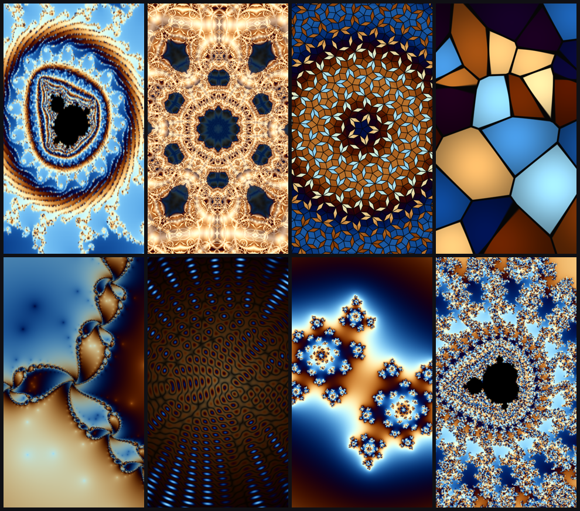

# マンデルブロ・ドリフト

数学の美しい模様が、スマホやパソコンの画面の上で滑らかに変化し続けるアプリです。
マンデルブロ集合の奥深くへ潜っていくツアーをはじめ、計算だけで描く23種類の模様を、端末のGPUやCPUを使ってその場で描き続けます。



## 入っている模様

| 模様 | どんなものか |
| --- | --- |
| マンデルブロ集合 | 8つの名所へ自動で潜るツアー。奥には小さなマンデルブロ集合が待っている |
| ジュリア集合 | 形を決める値が円を描いて動き、図形がゆっくり姿を変える |
| ニュートン法フラクタル | z³ = 1 の3つの解のどれにたどり着くかで塗り分ける |
| 黄金角の種の並び | ひまわりの種の並び。角度が黄金角に近づくと隙間なく詰まる |
| 反応拡散（チューリング模様） | 2つの物質が広がりながら反応し、水玉やしま模様が育つ |
| ストレンジアトラクタ | 1つの式を何百万回も繰り返して、点が絹のような曲線に集まる |
| マウラーのバラ | 花びらの曲線を一定の角度で飛び飛びに結んだ幾何学模様 |
| ボロノイ図（ステンドグラス） | 動く種にいちばん近い場所で塗り分ける |
| ペンローズ・タイリング | 2種類のひし形だけで、同じ並びを繰り返さずに敷き詰める |
| L-system（植物の枝分かれ） | 文字の書き換え規則から、草・樹・ドラゴン曲線・雪片が育つ |
| 波の干渉 | 動く波源から広がる波が、強め合い打ち消し合う |
| 万華鏡（18種類） | 宝石のレース・エメラルドとサファイア・星屑・無限トンネル（基本・らせん・宝石の回廊・光の輪・二つの渦）・双曲の鏡・アポロニウスのレース・流れるガラス（宝石色・夕焼け・オーロラ・大理石・オパール）・光の糸・ガラスの破片・花びらの曼荼羅が30秒ごとに切り替わる |
| 水の底でゆらめく光 | 水面で曲がった光が、底に揺れる網目を描く |
| 星雲の中を飛ぶ | 色とりどりのガスと星の中を、奥へ奥へと進む |
| 雪の結晶が育つ | 6方向に枝を伸ばして育ち、約24秒ごとに新しい結晶になる |
| シャボン玉 | 薄い膜に光が干渉して、虹色が流れる |
| 宝石の城（6種類） | メンガーのスポンジが並ぶ街を飛び抜ける。基本・キリモミ飛行・色の波・ネオンの街・黄金の城・水晶の城が30秒ごとに切り替わる |
| 4次元の立体 | 超立方体・正二十四胞体・正六百胞体が4次元で回転する |
| 光の群れ | 数百の光の粒が、近くの仲間だけを見て群れになって流れる |
| 光る洞窟を飛ぶ | 曲がりくねった光る洞窟を、カーブで体を傾けながら進む |
| 夕暮れの大地を飛ぶ | 夕日に向かって、山と湖の上を低空で飛ぶ |
| ワープ航行 | 星が光の筋になって、中心から外へ流れ去る |
| 没入の旅（10種類） | 雲海・深海・夜の光の森・ネオンの摩天楼・小惑星帯・シンセウェイヴの道・夕暮れの海・氷の峡谷・溶岩の洞窟・オーロラの雪原を、30秒ごとに旅する |

「模様」ボタンで選べます。万華鏡（18種類）・宝石の城（6種類）・没入の旅（10種類）は、好きな種類を選んで始められ、「ずっと見る」ボタンで同じ種類を見続けることもできます。「おまかせで次々と切り替える」をオンにすると、約45秒ごとに次の模様へ移ります。
フラクタル3種類（マンデルブロ・ジュリア・ニュートン法）は、指やマウスで動かしたり拡大したりできます。

「音」ボタンで、模様に合った環境音（静かな和音・洞窟の響きと水滴・風・ワープの唸り）が鳴ります。音はその場で計算して作っているので、音のファイルは入っていません。

## 入れ方

最新版は、このページ右側の **Releases** からダウンロードできます。

### Android

1. `mandelbrot-drift_*.apk` をスマホでダウンロードして開きます。
2. 「この提供元のアプリを許可」の確認が出たら許可します。

### Ubuntu

`mandelbrot-drift_*_all.deb` をダウンロードして、端末で次を実行します。

```
sudo apt install ~/ダウンロード/mandelbrot-drift_*_all.deb
```

アプリ一覧の「マンデルブロ・ドリフト」から起動すると、ブラウザの窓で開きます。
消すときは `sudo apt remove mandelbrot-drift` です。

### ブラウザ

[web/index.html](web/index.html) は1つのファイルだけで動きます。WebGL2が使えるブラウザで開いてください。

## 版による違い

| | Android版 | パソコン版（ブラウザ・Ubuntu） |
| --- | --- | --- |
| 模様の数 | 23種類 | 23種類 |
| マンデルブロ集合の深さ | 約1万倍まで | 約1200億倍まで（摂動法） |
| 画質の自動調整 | 解像度のみ | 解像度と、1画素を最大9回計算して平均 |
| アトラクタの計算 | CPU 1コア | CPUの全コア |
| 反応拡散の計算 | CPU | GPU |
| 見回す（宝石の城・3つの景色・没入の旅） | スマホを傾ける | マウスやタッチでドラッグ |

## 自分でビルドする

[Flutter](https://flutter.dev/) が入っていれば、次でAndroid版のAPKを作れます。

```
flutter build apk --release
```

Ubuntu用のDEBは `bash tools/build_deb.sh` で `dist/` に作られます。

## ファイルの場所

- `lib/` … Android版のプログラム（Dart）
- `shaders/mandelbrot.frag` … Android版のGPUで描く部分
- `web/index.html` … ブラウザ版・Ubuntu版（1ファイル）
- `packaging/deb/` … Ubuntu用パッケージの材料
- `tools/` … 補助スクリプト

## 作者・ライセンス

作者：飯田顕治（[kenjiiida-commits](https://github.com/kenjiiida-commits)）

[MIT License](LICENSE) で公開しています。自由に使ったり、改造したり、配ったりできます。
